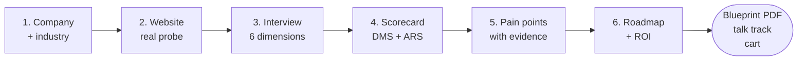

# Cradilot — the AI SME Digital Growth Advisor

**Turns "should I digitalise?" into a costed 12-month plan before the sales visit ends.**

Cradilot interviews a small-business owner the way a senior consultant would, scores
what they actually said with deterministic rules, and prints a costed blueprint the
owner can act on. It is not a chatbot: there is no prompt box, and the AI is never
allowed to invent a number.

[](https://github.com/wonghanz/cradilot-open/actions/workflows/ci.yml)

---

## Who this is for

| You are… | You get | Start here |
|---|---|---|
| **A PM evaluating or spec'ing this** | what a session produces, what is measured vs generated, the known limits | [How a session works](#how-a-session-works) · [What it will not do](#what-it-will-not-do) · [FAQ](#questions-a-pm-asks-first) |
| **A sales or consulting team** | a scored report, ranked pain points backed by the owner's own words, and a talk track to open the meeting with | [What you walk away with](#what-you-walk-away-with) |
| **An SME owner (the end user)** | a plain answer to *where do I start, what will it cost, when do I get it back* | [A session, step by step](#a-session-step-by-step) |
| **An engineer** | FastAPI + SSE, provider-agnostic LLM client, evidence store, PDF compiler, 229 tests | [Run it in three minutes](#run-it-in-three-minutes) · [Under the hood](#under-the-hood) |

---

## The problem it was built for

Written as the entry to the **AI Horizon Solution Challenge 2026**, run by
**Exabytes Malaysia** — project title *AI SME Digital Growth Advisor*, tagline
*"Helping SMEs Discover Their Next Digital Step"*. The brief put the problem plainly:

> "Over 95% of Malaysian businesses are SMEs. Many know they should digitalise or
> adopt AI, but struggle to answer questions like: Where should I start? Which
> investment gives me the biggest impact? Am I ready for AI? Which tools should I
> implement first? How much will it cost? What ROI can I expect?"

Today that conversation runs on a consultant's gut feel and a generic slide deck. The
owner cannot tell whether the advice is about *their* business; the seller cannot
defend the numbers. Cradilot's answer: ask structured questions, measure what is
answerable, and let arithmetic — not the model — produce every figure.

---

## How a session works



### A session, step by step

| Step | What the owner sees | What is actually happening |
|---|---|---|
| **1. Company & industry** | Type a name; the industry recognises itself from the description | Matches 10 industry profiles, on English or Malay-English wording |
| **2. Website check** | Their own site, graded, with the reason | A real TLS handshake, response headers, tech fingerprint, SPF/DMARC — measured now, not assumed |
| **3. The interview** | Questions that follow their answers, not a fixed form | Six digital-maturity dimensions; every fact stored *with the quote it came from* |
| **4. Scorecard** | A digital-maturity score and an AI-readiness score, explained | Rule-scored from verified answers. The AI writes only the plain-language reading |
| **5. Pain points** | Their top problems, ranked, each quoting what they said | Evidence binding: a pain point with no answer behind it cannot appear |
| **6. Plan & payback** | Phased 12-month roadmap, options compared, cost vs return | Prices come from *your* catalogue; payback is computed from hours and costs the owner stated |

---

## What you walk away with

* **A blueprint PDF** — 8 pages, or 9 when option comparisons are included, guarded
  by a length test so it cannot sprawl. Scorecard, ranked pain points with their
  evidence quotes, the phased plan, the ROI settlement, and a website-inspection
  appendix. Compiled with Typst, so the layout is reproducible rather than "close
  enough".
* **A talk track** — three stages for the opening conversation: a hook naming the
  owner's own top pain points, a trust anchor that explains the readiness verdict, and
  an ROI closer quoting the measured benefit. Generated from the report, not improvised.
* **A cart** — recommended line items with SKUs and annual amounts, ready to hand to
  whoever fulfils.
* **An audit trail** — every figure traces back to an answer, and every unanswered
  question stays visible as unanswered instead of quietly scoring zero.

---

## What it will not do

Read this before demoing to a customer. Four rules, each held by a test rather than a
guideline:

**1. The AI cannot make a number.** Scores, losses, payback and prices are arithmetic
over verified answers; the model writes prose and follow-up questions only. The code
says it bluntly:

> "The model's loss figure is not allowed into the books: that would be inventing a
> number the customer never calculated." — `core/sql_wiki_engine.py`
>
> *原句：「模型给的 loss_myr 不许入账：那是在替客户编一个他没算过的数字。」*

**2. When no AI is available, the fallback text carries no statistics at all.**
Degraded copy is written to be useless as a claim, and it announces itself:
`[Rule engine mode - the AI narrative layer is currently unavailable]`. The rule in
`llm/engine_client.py` is that such text must contain no figures at all, because a
salesperson reads it aloud as "the AI's analysis of your company".

**3. Money appears once, late, and from the owner's own inputs.** Detection records
problems at zero cost; the ROI stage allocates savings from what the owner said, split
evenly rather than estimated per item, so the same saved hours cannot be counted twice
across CRM and reconciliation.

**4. Unmeasured reads as unmeasured.** A website check that did not run is reported as
"not tested", never as "tested and clean".

The consequence to design around: **with no AI engine at all, the scores, pain-point
ranking, roadmap and PDF are still correct.** Only the commentary degrades. That
asymmetry is the point of the architecture.

---

## Run it in three minutes

```bash
python -m venv .venv && source .venv/bin/activate     # Python 3.12
pip install -r requirements.txt
cp .env.example .env                                   # add your AI key — or skip it
python app.py
```

Open `http://<server-address>:8000` in a browser, then confirm what is really driving
the answers:

```bash
curl http://<server-address>:8000/api/system/engine-status
# {"provider": "gemini", "model": "gemini-2.5-flash", "api_key_present": true,
#  "reachable": true, "degraded_copy_in_use": false, …}
```

`reachable: false` is not a cosmetic warning — it means the prose you are reading came
from the built-in rule engine, and the console labels it that way on screen.

---

## Pick your AI engine

Bring your own key. No key is committed, no endpoint accepts a key over HTTP, and
`.env` is gitignored.

| Engine | Configure | Default model | Why choose it |
|---|---|---|---|
| **Google Gemini** | `CRADILOT_LLM_PROVIDER=gemini` + `GEMINI_API_KEY` | `gemini-2.5-flash` | fastest to a working demo |
| **OpenAI** | `CRADILOT_LLM_PROVIDER=openai` + `OPENAI_API_KEY` | `gpt-4o-mini` | |
| **Any OpenAI-compatible service** | as above + `CRADILOT_OPENAI_BASE_URL` | `gpt-4o-mini` | OpenRouter, DeepSeek, vLLM, llama.cpp |
| **Self-hosted Ollama** | `CRADILOT_LLM_PROVIDER=ollama` + `CRADILOT_OLLAMA_URL` | `gemma3:12b` | customer data never leaves your network |
| **None** | leave it blank | — | scoring, pricing and the PDF still work |

Leave `CRADILOT_LLM_PROVIDER` unset and the provider is inferred from whichever
credential is present; override the model with `CRADILOT_MODEL`. There is deliberately
**no default Ollama address** — a guessed URL is how a demo silently runs on canned copy
while everyone believes the model answered.

---

## Make it your company's

The original build lived inside one partner's sales motion. This snapshot carries no
identity, and three variables give it yours — no front-end file needs editing:

```bash
CRADILOT_VENDOR_NAME="Northgate Digital"      # console, PDF letterhead, talk tracks
CRADILOT_VENDOR_DOMAIN=northgate.example
CRADILOT_REPORT_PREFIX=NGD                    # case reference on report IDs
```

Then point it at your price list:

```bash
CRADILOT_PRODUCT_CATALOG=./data/my_catalog.json
```

The bundled 18-SKU catalogue is labelled `SAMPLE DATA - not your price list` inside the
file itself. **Replace it before you quote anyone.** Schema, which fields are
load-bearing, and what breaks when you rename a SKU:
**[docs/ADAPTING.md](docs/ADAPTING.md)** — including
[how to move beyond the Malaysian market](docs/ADAPTING.md#5-adapting-beyond-malaysia).

---

## Questions a PM asks first

**Where does customer data go?** A local SQLite file (`data/cradilot_wiki.db`) and a
leads file (`data/sales_leads.jsonl`). Both are gitignored — the leads file holds
contact details and must never be committed. With `CRADILOT_LLM_PROVIDER=ollama`
nothing leaves your network; with a cloud key, interview answers are sent to that
provider as prompt text, like any other AI tool.

**What does a session cost in tokens?** A handful of bounded calls — the narrative
layers are capped at 250–700 tokens each, and the scores need no model at all.

**Can it run offline, or on a laptop at a customer site?** Yes: Ollama locally, or no
engine at all with the rule layers still producing the report.

**What if the AI writes something wrong?** It can misphrase the reading; it cannot
change a score, a price or a pain-point ranking, because those never pass through it.
The degraded path is labelled both on screen and in the API payload
(`degraded_copy_in_use`).

**Is industry coverage configurable?** Yes — `data/industry_catalog.json` is the single
shared source for the picker and the backend. Ten Malaysian profiles ship as the
default; add or replace rows there.

**Can we fine-tune a model on this domain?** `training/` has the QLoRA config and the
Ollama `Modelfile`; `scripts/generate_sft_dataset.py` regenerates the training corpus.

**What is not included?** The contest brief, the partner's internal documents, the
third-party PDFs and the ~8 MB fine-tuning corpus — see
[What is not in this snapshot](#what-is-not-in-this-snapshot).

**License?** MIT, so it can ship inside a commercial offering.

---

## Under the hood

```
app.py                FastAPI surface: 24 routes, SSE streaming, branding injection
config.py             every tunable: engine choice, vendor identity, paths, .env loader
llm/engine_client.py  one contract over Ollama / Gemini / OpenAI-compatible / off
core/
  agentic_diagnostic.py   the interview loop and follow-up probes
  sql_wiki_engine.py      evidence store: facts, quotes, coverage, readiness
  recommendation.py       roadmap phasing, option comparison, loss allocation
  dms_engine / ars_engine deterministic scoring
  web_scraper.py          real TLS/header probes behind an SSRF blocklist
  dev_audit.py            passive security & leaked-credential review
typst_generator/      compiles the blueprint PDF
data/                 industry catalog, sample product catalog, knowledge base
sales/                lead hand-off: cart, talk track, dispatch
static/               the console — HTML/CSS/JS, no build step
training/             QLoRA config + Modelfile for a specialised model
docs/                 ADAPTING.md + the original pitch and demo scripts
```

### Tests and CI

```bash
pip install -r requirements-dev.txt
python -m pytest -q                    # 229 passed, 6 skipped — with no engine configured
python scripts/check_no_secrets.py     # working tree; add --history for every git blob
python scripts/check_release_gates.py  # no vendor identity, hostnames or customer data
```

229 tests pin the scoring contracts, evidence binding, the pricing invariants (a
compared-but-not-sold option may never reach a budget line or the cart), the rendered
PDF text and the UI branding rules. The 6 skips are fine-tuning-corpus checks: that
dataset is generated, not committed. CI runs the suite, the credential scan, a
boots-with-no-engine check and a docs-hygiene check on every push.

### What is not in this snapshot

* **The contest brief and the partner's internal documents** — third-party material.
  `docs/` keeps the pitch deck and demo scripts, neutralised.
* **The fine-tuning corpus** (~8 MB of SFT/DPO pairs) — recreate it with
  `python scripts/generate_sft_dataset.py`; the integrity tests then un-skip.
* **Any credentials or internal hostnames** — scanned across every git object before
  publication, and CI keeps scanning.
* **A usable price list** — the sample figures exist so the pricing layer has something
  real-shaped to compute over. They are not your prices.

---

## License

MIT — see [LICENSE](LICENSE).
